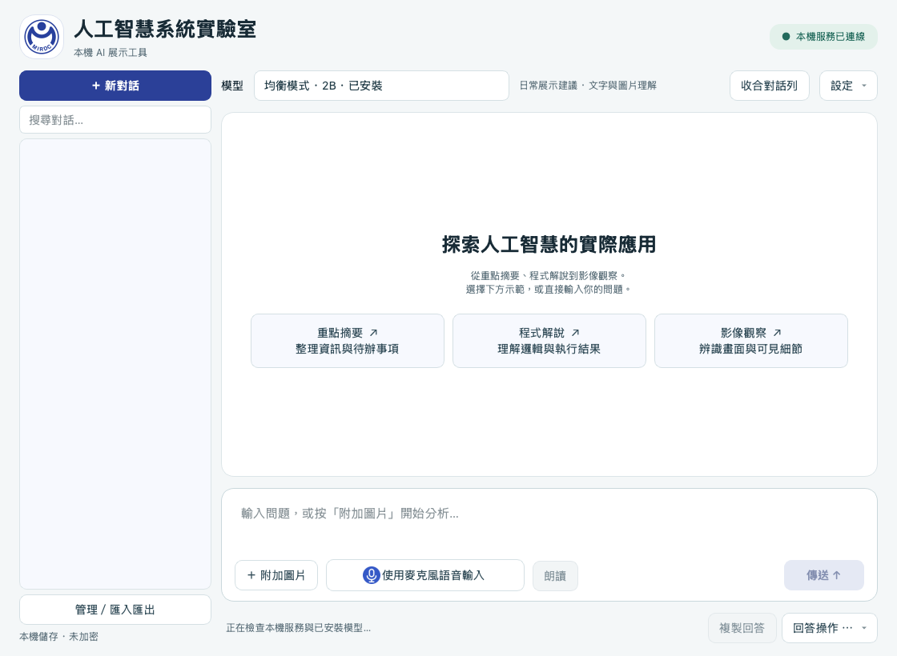

# ollama-VLM · Windows 11 x64

Windows 專用版本：本機 Ollama 文字／圖片聊天、串流回答、逐框 AI 預覽、人工調整、PNG／專案 JSON／Labelme 匯出與本機對話紀錄。

**目前為 Windows 移植版，尚未完成 Windows 11 實機桌面／模型驗收。** Mac 上通過的測試與 Windows 套件可下載，不能等同所有 Windows 功能已驗證。驗證進度見 [VALIDATION.md](VALIDATION.md)。



上圖沿用原專案的 Mac 操作示意，並非 Windows 實測截圖；Windows 字型與縮放效果需實機確認。

## 第一次安裝

適用原生 **Windows 11 x64 + CPython 3.14 x64**；不包含 Windows ARM、32 位元、WSL 或獨立 EXE。建議 16GB 記憶體、基本方案至少 15GB 可用磁碟，九模型方案至少 30GB；顯示卡與模型記憶體另行實測。

1. 從 [Python 官方 Windows 下載頁](https://www.python.org/downloads/windows/) 選 **Python 3.14.x Windows installer (64-bit)**，不要誤選 3.15、ARM64 或 embeddable。安裝 Python launcher；重開終端機，確認 `py -3.14 --version`。有官方 install manager 者可依官方介面加入 3.14，再確認相同指令。
2. 從 [Ollama 官方頁](https://ollama.com/download/windows) 安裝，重開終端機確認 `ollama --version`。顯示卡驅動依 [官方需求](https://docs.ollama.com/windows) 處理。
3. 在本儲存庫按 **Code → Download ZIP** 後完整解壓至可寫入路徑，例如 `C:\AI-Lab\ollama-VLM-win11`。不要直接在 ZIP 內執行，也不要複製 Mac 的 `.venv`。若使用 Git：

   ```powershell
   git clone https://github.com/orinaisl33-max/ollama-VLM-win11.git
   Set-Location ollama-VLM-win11
   ```
4. 雙擊 **`restore_windows.cmd`**，預設基本方案：顯示下載範圍後輸入 `YES`，才建立 venv、安裝鎖定套件及下載 Qwen3.5 2B。套件 hash／模型 digest 必須通過，最後執行環境與實際圖文檢查；按任意鍵結束。
5. 雙擊 **`run_windows.cmd`** 開啟。新服務只監聽 `127.0.0.1:11434`；已有 Ollama 服務則沿用，不會停止或改動它。程式沿用既有模型，但首次安裝仍須確認下載／校驗結果。

若使用命令列自動化，請在專案根目錄執行 Python 入口（不含雙擊啟動檔的 pause）：

```powershell
py -3.14 scripts/restore_windows.py --profile basic --yes
.\run_windows.cmd
```

完整九模型方案（不含語音）：

```powershell
py -3.14 scripts/restore_windows.py --profile full --yes
```

| 入口 | 用途 |
| --- | --- |
| `install_windows.cmd` | 只建立／檢查 `.venv` 及安裝套件，不下載模型 |
| `restore_windows.cmd` | 套件、模型及驗收；預設 basic，可附 `--profile full` |
| `run_windows.cmd` | 日常啟動，必要時啟動本機 Ollama |
| `run_windows.cmd --check` | 只讀環境檢查，不啟動服務／GUI、不下載模型 |

不需要執行 Activate.ps1、調低 PowerShell 執行原則或使用 sudo／管理者 pip。失敗時畫面保留並傳回非零狀態，不會自動刪除 `.venv` 或私人資料。

## 第一次操作與驗收

- 選已安裝圖文模型，文字提問應收到完整回答。
- 附加 [測試圖](測試圖/README.md)，核對圖片內容；先問顏色或位置，不把流暢回答當成正確答案。
- 「框選／匯出」中先填「人物」等明確目標；AI 上限預設 10，可選 1–20。收到完整有效座標就先逐框預覽，完整驗證後才套用。取消或失敗保留原標註。
- 人工移動／調整框、改名、刪除、復原／重做後，匯出並實際開檔確認。標註使用最長邊 1024 的前處理圖座標，不是原圖解析度。
- 核對對話保存、重新開啟、生成時取消、關閉程式及 Windows 顯示縮放 100%／125%／150%。
- **此版尚未提供麥克風輸入及語音朗讀**，相關功能會停用／顯示限制；不影響鍵盤、圖片、框選或匯出。Mac 語音引擎不能直接搬到 Windows。

## 安全、資料與故障排除

套件僅從官方 PyPI 安裝 Windows x64 wheel，固定版本並強制 SHA256；模型名稱與 digest 見 `environment.lock.json`。標籤內容改變時停止，由維護者重新核實，不要自行取消校驗。該模型內容基準沿用 Mac 專案，Windows 執行品質仍需驗收。

程式固定連線本機 Ollama，不使用雲端推論；模型／套件下載會連線供應來源。啟動器只替自己啟動的服務設定停用雲端與單模型／單並行，不能更改既有服務設定；如需統一設定，先正常退出 Ollama，再依官方說明配置使用者環境變數後重開。

`.venv/`、`.logs/`、模型、錄音、私人對話及金鑰不在儲存庫。對話資料使用 Qt 的使用者應用程式資料路徑，不會隨本程式資料夾完整刪除。私人圖片請放在 `private/`，不要放公開測試圖資料夾。

| 問題 | 處理 |
| --- | --- |
| 找不到 `py` 或 Python 3.14 | 安裝官方 Python 3.14 x64 及 launcher，重開終端機 |
| 找不到 Ollama | 安裝官方 Windows 版本，確認新終端機可執行 `ollama --version` |
| 舊 `.venv` 不符 | 備份並移出原位置，再重建；不要複製 Mac venv |
| SHA256／模型 digest 不符 | 停止，保留錯誤，請維護者核實，不取消校驗 |
| Qt DLL 載入失敗 | 確認 x64，依官方錯誤指示檢查 Microsoft VC++ x64 runtime，不下載第三方單顆 DLL |
| SmartScreen 或防毒提示 | 先核對來源、簽章與實際提示；不要關閉整體安全機制，企業管制需由管理者處理 |
| 無法連線 | 檢查 `.logs/ollama.log`、本機 11434；不開放外網監聽或防火牆埠 |
| 文字／圖片慢 | 從 2B 或更小圖文模型起步，縮短輸出，觀察 RAM／VRAM；速度依硬體而異 |

更嚴格的只讀檢查（要求模型與服務可用）：

```powershell
.\.venv\Scripts\python.exe scripts/check_install.py --require-model
```

關閉程式並備份個人修改後，Git 使用者可 `git pull --ff-only` 更新；ZIP 使用者下載至新資料夾重建。不要強制重設丟掉修改。

## 開發、Codex 與來源

[使用 Codex 協助安裝](docs/INSTALL_WITH_CODEX.md) · [Windows 驗收表](docs/WINDOWS_ACCEPTANCE.md) · [驗證紀錄](VALIDATION.md)

```powershell
.\.venv\Scripts\python.exe -m pip install --only-binary=:all: ruff==0.17.0
.\.venv\Scripts\python.exe -m ruff check main.py labchat scripts tests
$env:QT_QPA_PLATFORM = 'offscreen'
.\.venv\Scripts\python.exe -m unittest discover -s tests
Remove-Item Env:QT_QPA_PLATFORM
```

offscreen 用於測試，不能取代桌面 GUI；日常執行前移除。自動化 CI 使用 GitHub 的 Windows runner，也不能視為使用者 Windows 11 GPU／實機驗收。

程式衍生自 [Mac 原專案](https://github.com/orinaisl33-max/ollama-VLM)，本 Windows 副本獨立維護；未複製 Mac 環境、模型或私人紀錄。既有 Logo 與素材權利不因發布而另行授權。
